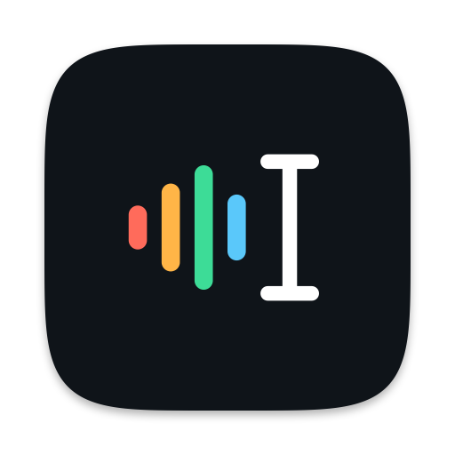
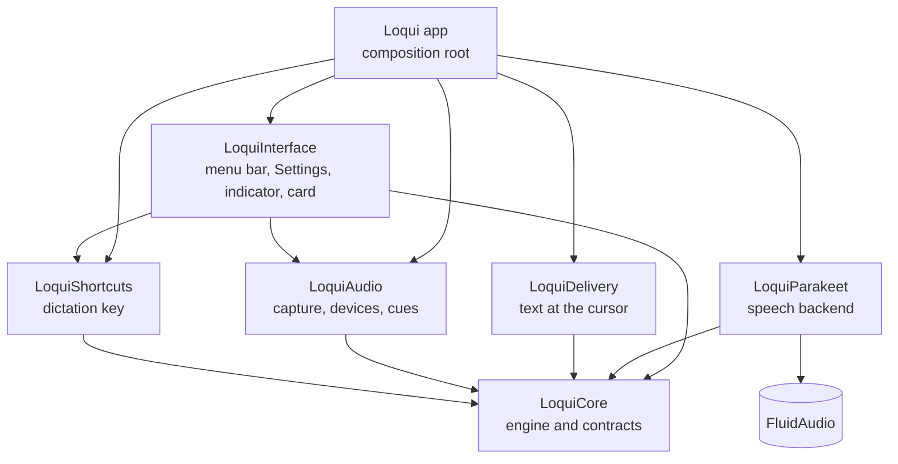

<p align="center">
  
</p>

# Loqui

Loqui is private, on-device dictation for macOS. Hold a key, speak, and your
words appear at the cursor in whatever app you are using. Speech never leaves
your Mac: transcription runs locally with NVIDIA's Parakeet TDT 0.6B v2 model on
Apple Silicon.

## What it does

- **Hold to dictate.** Hold the dictation key (Right Option by default), wait
  for the short ready chime, speak, and release. Double-tap the key for
  hands-free mode, then tap it once to stop.
- **Live drafts.** Words appear at the cursor while you speak and are replaced
  by one final, complete transcription when you stop.
- **Works where you type.** Text fields that support Accessibility are edited in
  place. Editors and GPU-rendered terminals that don't receive the text as
  keystrokes instead.
- **Recording indicator.** A small pill in Loqui's Spectrum colors floats above
  the Dock while Loqui listens, following your voice level.
- **Transcript card.** If nothing editable has focus, Loqui doesn't type into
  the void. It shows your words in a card with a Copy button.
- **Settings.** Choose the dictation key (Right Option, Right Command, Right
  Control, or Fn), toggle hands-free mode, pick the microphone, and turn sound
  cues and the indicator on or off. Open Settings from the menu bar icon, with
  ⌘, or by clicking Loqui in the Dock.

## Requirements

- macOS 14 or newer on Apple Silicon. Intel Macs and Rosetta get a clear
  unsupported-hardware message instead of a crash.
- Microphone access, and Accessibility access so Loqui can type at the cursor.
- About 470 MB for the speech model. Packaged apps include it.
- Xcode or the Command Line Tools with Swift 6, and Python 3.9+ for model setup.

## Getting started

```sh
./setup.sh              # download and verify the pinned model, build once
./scripts/deploy.sh     # build, sign, and install /Applications/Loqui.app
```

`deploy.sh` signs with the first Apple Development identity in your keychain
(set `LOQUI_DEVELOPMENT_TEAM` to choose a team), verifies the bundle, swaps it
into `/Applications` atomically, and relaunches Loqui if it was running. Without
a certificate it signs ad-hoc, and macOS asks again for Microphone and
Accessibility after each install.

To build the app bundle in place without installing it:

```sh
./bundle.sh
open -a "$PWD/Loqui.app"
```

After switching signing identities, clear the stale Accessibility grant once:

```sh
tccutil reset Accessibility com.benniekingwood.loqui
```

## Architecture

Loqui is a Swift package of small modules with one-way dependencies. Every
module talks to the others through contracts defined in `LoquiCore`, so a
component can be replaced without touching the rest.



| Module | Responsibility |
|---|---|
| `LoquiCore` | The dictation engine and state machine, plus the contracts every other module implements: recording, speech, delivery, cues, and the shortcut model. Imports only Foundation, Combine, and os. |
| `LoquiAudio` | Microphone capture through an input-only audio unit, input-device selection, recording files, and sound cues. |
| `LoquiParakeet` | The speech backend. Verifies the pinned model and runs Parakeet through FluidAudio. The only module that imports FluidAudio. |
| `LoquiDelivery` | Places text at the cursor: Accessibility edits, keystroke drafts, the paste fallback, and focus detection. |
| `LoquiShortcuts` | The global dictation-key monitor and the shortcut recorder used by Settings. |
| `LoquiInterface` | The menu bar menu and icon, the Settings window, the recording indicator, and the transcript card. |
| `Loqui` | The app itself: `AppEnvironment` picks the concrete implementations, and `AppDelegate` runs the lifecycle. |

`LoquiArchitectureTests` enforces these boundaries on every test run. A module
that imports past its layer, a second package dependency, or any import of
FluidAudio outside `LoquiParakeet` fails the build.

### Swapping the speech backend

The engine depends only on `SpeechTranscribing` and `SpeechModelPreflighting`
from `LoquiCore`. A new backend is a module that implements both. Point
`AppEnvironment.live()` at it and nothing else changes.

### Performance

- Live drafts decode the recorder's in-memory 16 kHz samples. No snapshot file
  is written or read per draft, and a pass is skipped while no new audio has
  arrived.
- The verified model is re-checked on disk at most every 30 seconds rather than
  on every draft. The model manifest is decoded once.
- Weights stay resident between recordings, and each pass gets its own decoder
  state, so cancelling a draft cannot disturb the final transcription.
- Device setup, cue playback, resampling, and disk writes run off the main
  thread. The level meter is polled only while recording, so it never
  re-renders the menu or Settings.

## Speech model

Loqui runs [Parakeet TDT 0.6B v2](https://huggingface.co/nvidia/parakeet-tdt-0.6b-v2)
through [FluidAudio](https://github.com/FluidInference/FluidAudio) 0.17.4, its
only third-party dependency. Inference is offline: Loqui loads local models,
disables SDK network access, and never logs dictated text.

[`parakeet-model.json`](Loqui/Sources/LoquiParakeet/Resources/parakeet-model.json)
pins the model repository, an immutable revision, and the exact size and
SHA-256 of every Core ML file. [`dependencies.env`](dependencies.env) mirrors
the model identity and SDK version, and tests keep the two in sync. Setup,
bundling, and verification all use the same checker:

```sh
./scripts/dependency-tool.sh verify-model ./models/parakeet-tdt-0.6b-v2-coreml
```

Models are found in this order. An invalid match fails loudly instead of
silently falling back to other weights.

1. `LOQUI_MODEL_PATH`, an explicit directory.
2. `Contents/Resources/models/` inside the app bundle.
3. `models/` in the development checkout (`LOQUI_DEVELOPMENT_ROOT`, the
   checkout inferred from a SwiftPM build, or the working directory).
4. `~/Library/Application Support/Loqui/models/`.

To update the backend, review the SDK pin, the model revision, every file
digest, and the native inference check together.

## Development

```sh
swift test --package-path Loqui                     # every module's tests
bash tests/dependency-tool-fixtures.sh              # model installer
bash tests/signing-identity-tests.sh                # signing selection
bash tests/changelog-tests.sh                       # version and changelog checks
swiftlint lint --strict --config .swiftlint.yml
swiftformat --lint --config .swiftformat Loqui/Sources Loqui/Tests
```

Every pull request raises the version and records the change in
[CHANGELOG.md](CHANGELOG.md). Run `./scripts/changelog.sh bump patch` (or
`minor` or `major`) and describe the change in the new section. CI rejects a
pull request that skips this.

Open `Loqui/Package.swift` in Xcode to edit and run tests. The app needs a real
bundle for microphone and Accessibility access, so run it through `./bundle.sh`
or `./scripts/deploy.sh` rather than `swift run`. See
[docs/TESTING.md](docs/TESTING.md) for the real-model and microphone checks, and
[docs/RELEASING.md](docs/RELEASING.md) for signing, notarization, and releases.

## Licenses

The Parakeet TDT v2 model is licensed under CC BY 4.0 by NVIDIA. The Core ML
conversion is provided by FluidInference. FluidAudio is licensed under Apache
2.0. Both notices ship inside the app bundle.
